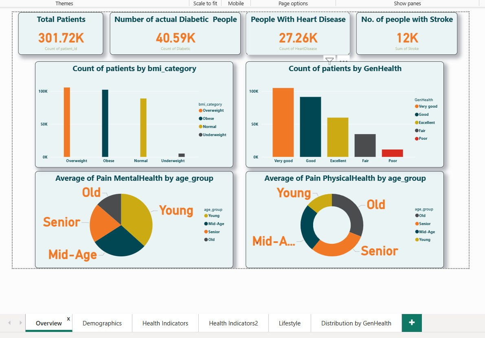
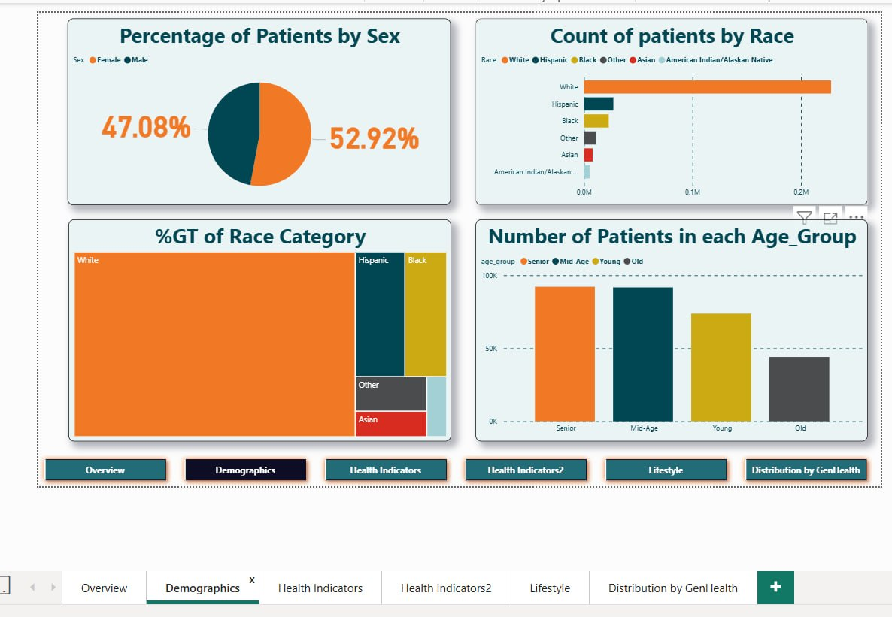
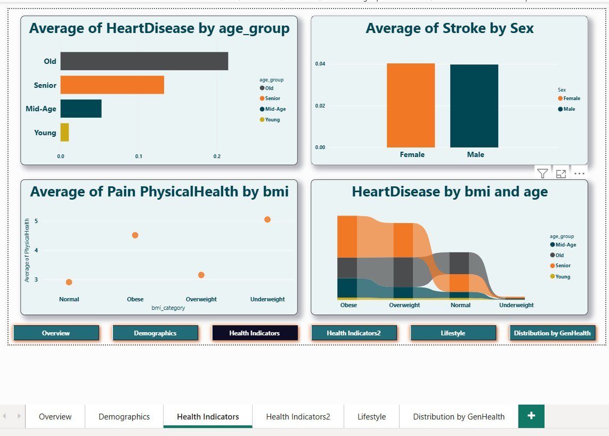
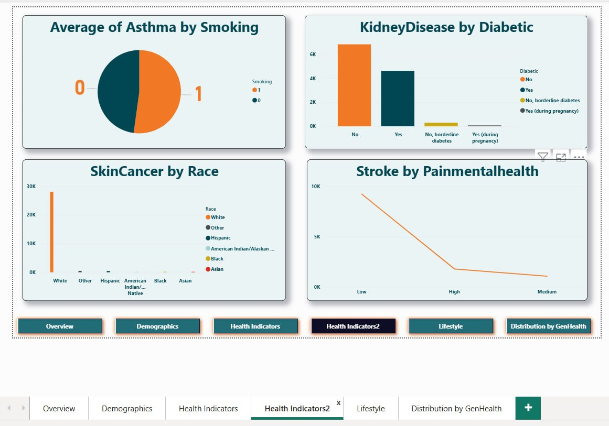
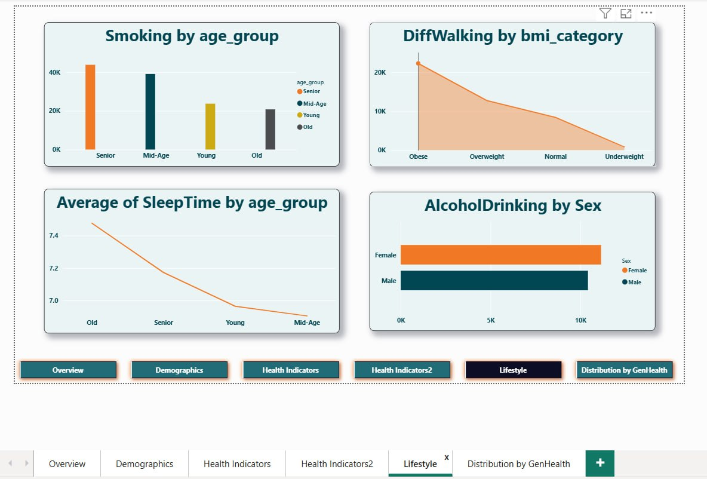
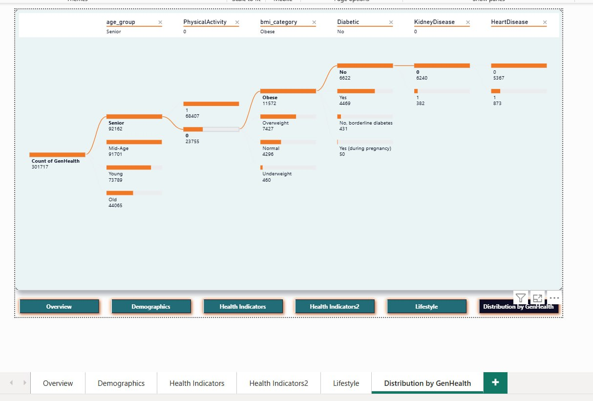
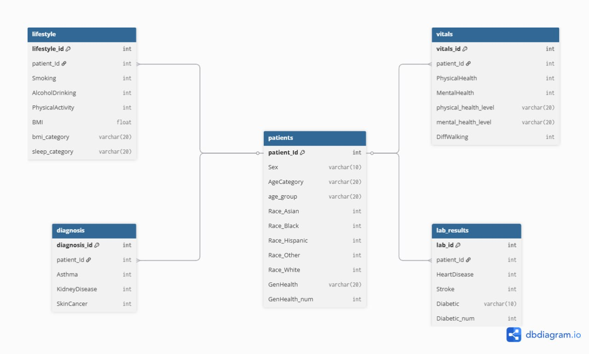

# Heart Disease Risk Analysis

DEPI capstone project (Data Analyst Specialist track, Digital Egypt Pioneers Initiative, MCIT). Built by a team of four.

We took the CDC's 2020 BRFSS health survey (about 319,795 responses, 18 predictor variables) and ran it through a full analysis pipeline: clean it in Python, store it in a normalized SQL Server database, query it with SQL, and present it in a six-page interactive Power BI dashboard.

After removing duplicates the dashboard works with about 301.7K unique patients.

## Pipeline

| Step | Tool | What we did |
| --- | --- | --- |
| 1. Clean and engineer features | Python (Pandas) | Removed duplicates, checked nulls, added a unique `patient_Id`, encoded Yes/No columns as 1/0, encoded diabetes status by severity, grouped age (4 life stages), BMI (WHO categories), sleep time and health days into buckets |
| 2. Model the data | SQL Server | Split the flat file into five tables in 3rd Normal Form, linked by `patient_Id`: `patients`, `lifestyle`, `vitals`, `diagnosis`, `lab_results` |
| 3. Analyse | SQL | Heart disease by age and sex, lifestyle against outcomes, overlap between conditions (INNER JOIN and GROUP BY queries) |
| 4. Visualise | Power BI | Six report pages: Overview, Demographics, Health Indicators, Health Indicators 2, Lifestyle, and a Decomposition Tree |

## Findings

- Heart disease risk stays low until about age 50, then rises sharply. The Old and Senior groups are the priority.
- Difficulty walking is a strong indicator of heart disease, comparable to smoking in the analysis.
- People with diabetes or kidney disease have a higher chance of heart disease than the general population.
- Obesity shows up as a dominant factor across the dashboard pages, and obese respondents report the most difficulty walking.
- Smokers show higher asthma prevalence. Skin cancer is most common among White respondents in this sample. Higher mental distress goes with more stroke cases.

The full write-up, with the recommendations, is in [`docs/Project-Documentation.pdf`](docs/Project-Documentation.pdf).

## Dashboard

| | |
| --- | --- |
|  |  |
|  |  |
|  |  |

The Power BI file is in [`dashboard/`](dashboard/). Open it with Power BI Desktop.

## Database design



## Repository layout

```
python/       data cleaning and normalization scripts
sql/          exploration and join queries
dashboard/    Power BI file (.pbix)
docs/         project documentation (PDF and DOCX) and ERD
screenshots/  dashboard pages and ERD image
```

## Data

The raw data is not included in this repository. It is the public CDC 2020 BRFSS dataset, available on Kaggle as "Personal Key Indicators of Heart Disease" (`heart_2020_cleaned.csv`). Put the CSV in the same folder as the scripts to run them.

## Tools

Python (Pandas, NumPy), SQL Server, Power BI.
